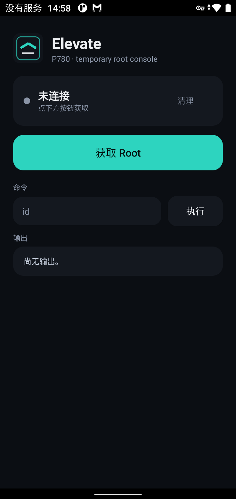

<div align="center">

# Elevate

**Temporary root console for the Rakuten Hand 5G (TINNO P780)**

[](#compatibility)
[](#compatibility)
[](#compatibility)
[](#capabilities)

一个 APK，一次点击，一次安装确认 —— 在这台 BL 锁定、SELinux Enforcing 的零售机上
取得 `uid=0` 的 root 控制台。**不写分区、不刷机、不关 SELinux**，重启即恢复。



</div>

---

## 目录

- [为什么用它](#为什么用它)
- [快速开始](#快速开始)
- [能力边界](#能力边界)
- [工作原理](#工作原理)
- [从源码构建](#从源码构建)
- [仓库结构](#仓库结构)
- [常见问题](#常见问题)
- [兼容性](#兼容性)
- [安全与免责](#安全与免责)
- [研究附录](#研究附录)

---

## 为什么用它

P780 的 bootloader 锁定、`ro.debuggable=0`、SELinux Enforcing，常规手段拿不到 root。
本工具利用内核页缓存写原语（CVE-2026-43284）在用户态完成提权，全程可逆：

| 特性 | 说明 |
|---|---|
| **一次点击** | 打开 App → 获取 Root → 安装确认，全程约 10 秒 |
| **可逆** | 只改页缓存，重启自动恢复；恢复出厂完全复原 |
| **不碰分区** | 不写 `/system`、`/vendor`，不刷 boot |
| **保持 Enforcing** | 不关闭 SELinux、不改策略 |
| **可回收** | 内置「清理」，随时回滚而无需重启 |

## 下载

**[⬇ Elevate 1.0](https://github.com/Chuniex-0631/elevate-p780/releases/latest)** —
从 Releases 页面下载 `Elevate-1.0.apk`（约 58 KB，已签名）。

仓库内也保留了一份副本：[`release/Elevate-1.0.apk`](release/Elevate-1.0.apk)。

## 快速开始

```text
1. 安装 release/Elevate-1.0.apk
2. 打开 Elevate，按提示授予「安装未知应用」权限
3. 点「获取 Root」
4. 系统弹出「要安装此应用吗？」→ 点「安装」
5. 若 Play Protect 提示风险 → 点「仍然安装」
6. 状态变为「已连接 · uid 0」，开始输入命令
```

常用命令：

```sh
id                       # uid=0(root) context=u:r:installd:s0
getenforce               # Enforcing
echo /data/data/*        # 枚举全部应用私有目录
```

重启后 root 消失，重复第 3 步即可。

## 能力边界

> 这是一个**文件级 root**，域为 `u:r:installd:s0`，不是 `su` 式的完整 shell。

| ✅ 可以做 | ❌ 不可以做 |
|---|---|
| 以 uid 0 读写 `/data`（应用目录、`/data/app`、`/data/dalvik-cache`、`/data/local/tmp`） | 写 `/system`、`/vendor` |
| 执行 `sh` 内建命令与脚本逻辑（循环、条件、重定向、通配） | 执行 `ls` / `cat` / `toybox` 等系统二进制 |
| 枚举全部 `/data/data`，读取任意可读文件（含系统文件） | 关闭 SELinux、修改策略 |
| 提取系统文件、备份应用数据 | 常驻守护进程、保持 root 跨重启 |

## 工作原理

```text
┌──────────────┐   ① 写入 52 个 16B 块     ┌────────────────────────────┐
│  Elevate App │ ─────────────────────────▶ │ /system/lib64/libc++.so    │
│  (untrusted) │   页缓存写原语              │ std::ostream::sentry 被劫持 │
└──────┬───────┘                            └────────────┬───────────────┘
       │ ② 安装内置触发包                                  │
       ▼                                                  │
┌──────────────┐   ③ installd 写日志        ┌────────────▼───────────────┐
│  13.5 KB     │ ─────────────────────────▶ │ libbase::LogMessage → 命中  │
│  dummy APK   │                            │ 钩子 → 载荷执行              │
└──────────────┘                            └────────────┬───────────────┘
                                                         │ ④ fork + exec
                                                         ▼
                                            ┌────────────────────────────┐
                                            │ uid 0 · u:r:installd:s0     │
                                            │ sh 轮询命令文件，结果写回     │
                                            └────────────────────────────┘
```

1. **写入**：DirtyFrag 用有效 ESP 报文把明文写进被 `splice` 钉住的页缓存页，
   逐块覆盖 `libc++.so`，在 `sentry` 入口装 16 字节跳板，载荷放进零引用的 `__do_get`；
2. **触发**：安装内置空包，`installd` 处理安装时经过 `libbase::LogMessage`；
3. **执行**：载荷在 `installd` 域 fork 出 `sh`，通过应用私有目录收发命令；
4. **回收**：清理时先发 `__quit` 退出守护进程，再从备份恢复库字节。

详细推导见 [研究附录](#研究附录)。

## 从源码构建

```bash
cd app/elevate
python build_elevate.py      # 产出 Elevate.apk（约 58 KB）
```

流水线：`aapt2 compile/link`（含 R.java）→ `javac --release 11` → `d8` →
NDK clang（native 探针）→ `zipalign` → `apksigner`。

## 仓库结构

| 路径 | 内容 |
|---|---|
| `app/elevate/` | App 源码、构建脚本、图标、内嵌触发包 |
| `release/` | 可直接安装的 APK |
| `docs/research/` | 完整研究记录：利用链、内核镜像、符号表、结构体偏移、ROM 提取 |
| `docs/rom/` | 该机型最终 ROM 的内容提取索引（5.7 GB，见 Release） |
| `tools/` | 可复跑的分析与探针工具 |

## 常见问题

**Q：重启后 root 没了？**
正常。本工具不写磁盘，重启即恢复；重新点一次「获取 Root」即可。

**Q：为什么要点「仍然安装」？**
触发包用自签名密钥，Play Protect 会提示一次风险，属预期行为。

**Q：能写 `/system` 吗？**
不能。`installd` 域对 `system_file` 只有读权限。系统文件是只读的，这是设计边界。

**Q：`ls`、`cat` 为什么用不了？**
这些是 toybox 二进制，`installd` 域没有 `system_file` 执行权限；只能用 `sh` 内建命令。
需要读写文件时，用重定向与 `read`/`echo` 组合。

**Q：能在别的机型上用吗？**
不能。载荷中的函数偏移与结构体布局是针对本机内核逐项验证的，换机型需要重新做偏移验证。

## 兼容性

| 项 | 值 |
|---|---|
| 机型 | Rakuten Hand 5G / TINNO P780 |
| 平台 | Qualcomm SM6375（holi / mannar） |
| 系统 | Android 11（API 30），`P780AE_11.0_RMN_JP_162` |
| 内核 | `5.4.233-qgki-gea5245e94afe-dirty`（Clang 11.0.2） |
| 指纹 | `Rakuten/P780/P780:11/RKQ1.210715.001/264:user/release-keys` |
| Bootloader | Locked（工具不需要解锁） |

## 许可

代码与文档采用 [MIT License](LICENSE)。随仓库附带的厂商固件、系统镜像与 ROM 提取内容，
版权归各自权利人所有，仅供个人研究与备份使用。

## 安全与免责

- 仅限机主本人设备的备份与研究用途；
- 本工具不提供解锁 bootloader、绕过账户锁或刷写分区的能力；
- 使用产生的一切后果由使用者承担；
- 发现安全问题请通过仓库 Issue 私下沟通，勿公开可复现细节。

## 研究附录

本项目源自一条完整的研究线：从页面缓存写原语，到内核镜像提取、符号表重建、
结构体偏移逐字段验证，最终落到这个 App。全部记录（含失败尝试与踩坑）保留在：

- [利用链与能力边界](docs/research/p780-dirtyfrag-live-exploit-20261025.md)
- [内核镜像与符号表](docs/research/p780-kernel-image-extraction-20261025.md)
- [结构体偏移验证](docs/research/p780-candidate-layout-20261025.md)
- [守护进程协议](docs/research/p780-root-daemon-20261025.md)
- [ROM 内容提取](docs/rom/README.md)
